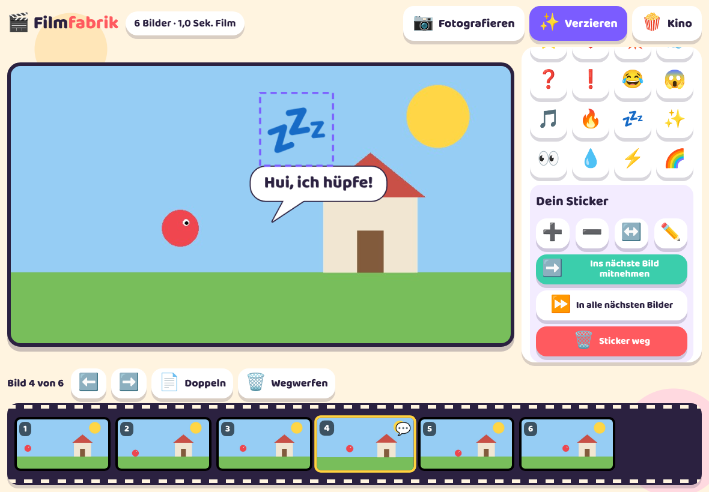

# 🎬 Filmfabrik

**Stop-Motion-Filme machen – kinderleicht, direkt im Browser.**
Fotografieren, Bilder sortieren, Sprechblasen und Sticker draufkleben, als Video speichern. Gebaut für Kinder ab ca. 6 Jahren, für Tablet und Handy.



## Funktionen

- 📷 **Fotografieren** mit großem Auslöser, Geisterbild (das letzte Foto liegt durchsichtig über der Kamera), 3-2-1-Selbstauslöser und Kamerawechsel. Alternativ lassen sich Fotos aus der Galerie holen.
- 🎞️ **Filmstreifen**: Bilder antippen, verschieben (Pfeile oder lange drücken und ziehen), doppeln, wegwerfen und zurückholen.
- ✨ **Verzieren**: Sprechblasen (reden, denken, rufen), Erzähl-Schild und 16 Sticker. Verschieben mit dem Finger, Größe mit zwei Fingern. „Ins nächste Bild mitnehmen“ kopiert einen Sticker ins nächste Bild, damit er sich mitbewegen kann.
- 🍿 **Kino**: Abspielen in drei Geschwindigkeiten, Endlosschleife und **Film speichern** als Video (MP4 oder WebM, je nach Browser). Über „Teilen“ landet er z. B. in der Fotos-App.
- 💾 **Automatisches Speichern** im Browser. Nach dem Schließen sind die Bilder noch da.
- 📴 **Offline-fähig** (PWA): Nach dem ersten Öffnen läuft die App auch ohne Internet und lässt sich als App-Symbol auf den Home-Bildschirm legen.
- 📱 **Layouts** für Tablet quer und hochkant sowie für Handys.

## Datenschutz

Alle Fotos und Filme bleiben **auf dem Gerät** (IndexedDB im Browser). Die App lädt nichts hoch und ruft keine fremden Server auf, auch die Schrift ist mitgeliefert.

## Benutzen

**Online:** https://dersold1.github.io/FilmFabrik/ öffnen. Wer selbst hostet, braucht **HTTPS**. Browser geben die Kamera nur über HTTPS (oder `localhost`) frei.

**Als App auf dem iPad/iPhone:** Seite in Safari öffnen → *Teilen* → *Zum Home-Bildschirm*.

**Lokal testen:**
```bash
python3 -m http.server 8000
# dann http://localhost:8000 öffnen
```
Einfaches Doppelklicken auf `index.html` funktioniert am Computer in Chrome/Edge, aber ohne Offline-Funktion. Auf iPad und iPhone geht es so nicht, weil iOS lokale HTML-Dateien nicht ausführt.

## Selbst hosten

Einfach alle Dateien in einen Ordner auf einen Webspace mit HTTPS kopieren. Es gibt keinen Build-Schritt und keine Abhängigkeiten.

| Datei | Zweck |
|---|---|
| `index.html` | die komplette App (HTML, CSS, JavaScript) |
| `sw.js` | Service Worker für den Offline-Betrieb |
| `manifest.json`, `icon-*.png` | App-Symbol und Home-Bildschirm |
| `fonts/` | Schrift „Baloo 2“ |

**Beim Aktualisieren** in `sw.js` die Versionsnummer (`filmfabrik-vX`) hochzählen.

## Lizenz

- Code: [MIT](LICENSE)
- Schrift „Baloo 2“: © The Baloo 2 Project Authors, [SIL Open Font License 1.1](fonts/OFL.txt)
- Emojis werden von der Systemschrift des Geräts dargestellt und sind nicht Teil dieses Repos.

---

### English

A kid-friendly stop-motion maker that runs entirely in the browser: take photos with onion skinning, reorder frames, add speech bubbles and stickers, then export a video. Works offline as a PWA, stores everything locally on the device and makes no external requests. No build step: just serve the files over HTTPS. UI language is German. Code under the MIT license, font under the OFL.
